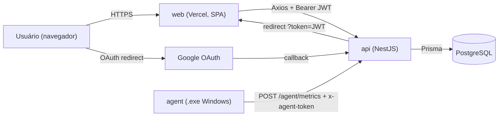
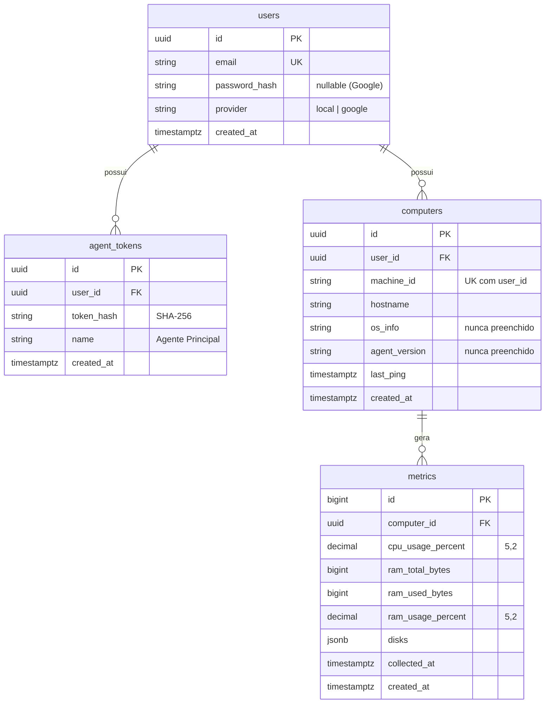

# Sentinel — Contexto Geral para Modelos de IA

> **Objetivo deste arquivo:** dar a qualquer modelo de IA (ou pessoa nova no projeto) um entendimento rápido e fiel do **estado real do código**: arquitetura, fluxos, contratos, convenções, pendências e armadilhas conhecidas.
>
> - Requisitos oficiais do desafio: [`docs/context/README.md`](./README.md) (fonte da verdade do **que** precisa ser entregue).
> - Este arquivo: fonte da verdade de **como está implementado hoje**.
> - Última análise: 2026-10-14 (branch local com alterações não commitadas).

---

## 1. Resumo do Produto

**Sentinel** (codinome interno: *Projeto James Bond*) é uma plataforma de monitoramento para Windows, criada como desafio técnico (8–12h de escopo). Jornada:

1. Usuário se cadastra (e-mail/senha) ou entra com Google.
2. Na área autenticada, gera uma **chave de agente** (token `stn_...`).
3. Baixa o agente Windows (`sentinel-agent.exe`), cola a chave e inicia.
4. O agente envia periodicamente CPU, RAM e discos para a API.
5. O dashboard mostra cada computador, status online/offline e a última leitura (polling de 5s).

---

## 2. Arquitetura

Monorepo com 3 componentes desacoplados:

```
project_james_bond/
├── web/     → Frontend  (React 19 + Vite 8 + Tailwind CSS 4 + TypeScript)
├── api/     → Backend   (NestJS 11 + Prisma 6 + PostgreSQL)
├── agent/   → Agente    (Python + psutil + requests + Tkinter → PyInstaller .exe)
└── docs/
    └── context/
        ├── README.md      → Requisitos do desafio
        └── AI_CONTEXT.md  → Este arquivo
```



### Duas credenciais distintas

| Credencial | Quem usa | Formato | Onde trafega | Armazenamento |
|---|---|---|---|---|
| **JWT de usuário** | Frontend | JWT HS256, `{ sub, email }`, expira em 1d | Header `Authorization: Bearer <jwt>` | `localStorage` (`@sentinel:token`) |
| **Token de agente** | Agente Windows | `stn_` + 48 hex (24 bytes aleatórios) | Header `x-agent-token: <token>` | Banco guarda **apenas SHA-256**; agente guarda em `config.json` |

---

## 3. Backend — `api/` (NestJS)

### 3.1 Módulos

| Módulo | Arquivos | Responsabilidade |
|---|---|---|
| `AppModule` | [app.module.ts](../../api/src/app.module.ts) | Raiz. Importa Prisma, Users, Auth, Config (global), Agent |
| `PrismaModule` | [prisma.service.ts](../../api/src/prisma/prisma.service.ts) | `PrismaClient` com connect/disconnect no ciclo de vida |
| `UsersModule` | [users.service.ts](../../api/src/users/users.service.ts) | `create`, `findByEmail`, `findById`, `findOrCreateGoogleUser` |
| `AuthModule` | [auth.controller.ts](../../api/src/auth/auth.controller.ts), [auth.service.ts](../../api/src/auth/auth.service.ts), `strategies/`, `guards/`, `dto/` | Registro, login, Google OAuth, emissão/validação de JWT |
| `AgentModule` | [agent.controller.ts](../../api/src/agent/agent.controller.ts), [agent.service.ts](../../api/src/agent/agent.service.ts), `dto/` | Geração de token de agente, ingestão de métricas, listagem de computadores |

### 3.2 Bootstrap ([main.ts](../../api/src/main.ts))

- `BigInt.prototype.toJSON` sobrescrito → serializa como `Number`.
- CORS: origem única `FRONTEND_URL` (fallback `http://localhost:5173`), `credentials: true`.
- `ValidationPipe` global: `whitelist`, `forbidNonWhitelisted`, `transform`.
- Porta: `PORT` (fallback `3000`).
- **Não há prefixo global** (`/api/v1` não existe).

### 3.3 Endpoints (estado atual)

| Método | Rota | Auth | Body / Header | Resposta |
|---|---|---|---|---|
| GET | `/` | — | — | "Hello World" (scaffold) |
| POST | `/auth/register` | — | `{ name, email, password }` | `201 { user: {id,email,createdAt}, accessToken }` / `409` e-mail duplicado |
| POST | `/auth/login` | — | `{ email, password }` | `200 { user, accessToken }` / `401 Credenciais inválidas` |
| GET | `/auth/google` | GoogleAuthGuard | — | Redirect para Google |
| GET | `/auth/google/callback` | GoogleAuthGuard | — | Redirect para `${FRONTEND_URL}/auth/success?token=<jwt>` |
| POST | `/agent/tokens` | JwtAuthGuard | — | `201 { token: "stn_..." }` (exibido **uma única vez**) |
| GET | `/agent/computers` | JwtAuthGuard | — | Lista de computadores **do usuário do JWT** com `metrics` = última leitura |
| POST | `/agent/metrics` | Token de agente (manual no service) | Header `x-agent-token` + `ReceiveMetricsDto` | `200 { status: "success" }` / `401` sem token ou token inválido / `400` payload inválido |

### 3.4 Fluxo de ingestão ([agent.service.ts](../../api/src/agent/agent.service.ts) → `receiveMetrics`)

1. Sem header `x-agent-token` → `401 Token do agente ausente`.
2. SHA-256 do token → `agentToken.findFirst({ tokenHash })`. Não achou → `401 Token inválido ou revogado`.
3. `userId` vem **do token**, nunca do payload (isso garante o isolamento entre usuários).
4. `computer.upsert` pela chave composta `unique_user_machine (userId, machineId)` → atualiza `hostname` e `lastPing`.
5. `metric.create` com `collectedAt = new Date()` (**hora do servidor**, não do agente).

### 3.5 Autenticação

- **Senha:** `bcrypt` com 10 salt rounds.
- **JWT:** `@nestjs/jwt`, secret `JWT_SECRET` (fallback hardcoded `secreto_temporario_desenvolvimento` em [auth.module.ts](../../api/src/auth/auth.module.ts) e [jwt.strategy.ts](../../api/src/auth/strategies/jwt.strategy.ts)), `expiresIn: '1d'`.
- **JwtStrategy:** extrai Bearer, `validate()` devolve `req.user = { id, email }`.
- **GoogleStrategy:** escopos `email`, `profile`; usa `ConfigService` para `GOOGLE_CLIENT_ID`, `GOOGLE_CLIENT_SECRET`, `GOOGLE_CALLBACK_URL`.
- **Google + conta local com mesmo e-mail:** `findOrCreateGoogleUser` reaproveita o usuário existente pelo e-mail (vinculação implícita).

### 3.6 Modelo de dados ([schema.prisma](../../api/prisma/schema.prisma) / [schema.sql](../../api/schema.sql))



- Todas as FKs com `ON DELETE CASCADE`.
- Índice `idx_metrics_computer_time (computer_id, collected_at DESC)`.
- Prisma mapeia camelCase (código) ↔ snake_case (banco) via `@map`.
- Schema aplicado com `npx prisma db push` (sem migrations versionadas).

---

## 4. Agente Windows — `agent/` ([agent.py](../../agent/agent.py))

### 4.1 Stack
- Python 3, `psutil==5.9.8`, `requests==2.31.0`, `tkinter` (stdlib).
- Empacotamento via PyInstaller → binário publicado em `web/public/sentinel-agent.exe` (~15 MB).

### 4.2 Estrutura do código
| Seção | Funções | Descrição |
|---|---|---|
| Configuração | `get_config_path`, `load_config`, `save_config` | `config.json` ao lado do `.exe` (ou do `.py`). Merge com defaults |
| Coletores | `get_machine_info`, `get_cpu_metrics`, `get_memory_metrics`, `get_disk_metrics`, `deliver_metrics(flags)` | Coleta apenas o que estiver habilitado nas flags |
| GUI | `SentinelAgentApp` | Janela Tkinter com tema escuro roxo |
| Worker | `_telemetry_worker` (thread daemon) | Loop: coleta → `POST` → log; dorme em fatias de 200ms |
| Encerramento | `_on_close` | `is_alive = False` + `root.destroy()` |

### 4.3 Configuração (`config.json`, ignorado no git)
```json
{
  "api_url": "http://localhost:3000/agent/metrics",
  "token": "",
  "interval_seconds": 5,
  "collect_cpu": true,
  "collect_ram": true,
  "collect_disks": true
}
```
- Intervalo padrão: **5s**. GUI aceita **1–300s** (Spinbox).
- `api_url` **não é editável pela GUI**, só pelo `config.json`.

### 4.4 GUI
- Campo de token, intervalo, checkboxes de privacidade (CPU/RAM/Discos).
- Botões "Pausar/Iniciar Monitoramento" e "Salvar Preferências".
- Console de logs com timestamp e status de cada envio.

### 4.5 Payload real enviado (contrato vigente)
```http
POST /agent/metrics
x-agent-token: stn_xxxxxxxxxxxxxxxxxxxxxxxxxxxxxxxxxxxxxxxxxxxxxxxx
Content-Type: application/json
```
```json
{
  "machineId": "DESKTOP-ABC-Windows",
  "hostname": "DESKTOP-ABC",
  "cpu_percent": 12.5,
  "memory_total_bytes": 17179869184,
  "memory_used_bytes": 8589934592,
  "memory_percent": 50.0,
  "disks": [
    { "device": "C:\\", "total_bytes": 512000000000, "used_bytes": 256000000000, "percent": 50.0 }
  ]
}
```
- `machineId` = `platform.node() + "-" + platform.system()` (derivado do hostname).
- Validado por [receive-metrics.dto.ts](../../api/src/agent/dto/receive-metrics.dto.ts).

> [!WARNING]
> O contrato descrito no [README.md raiz](../../README.md) (`POST /api/v1/metrics`, `Authorization: Bearer`, payload aninhado `cpu.usage_percent`, `machine_id`, `collected_at`, `os_info`, `agent_version`, `disks[].mount_point`) está **desatualizado**. O contrato vigente é o da seção 4.5.

---

## 5. Frontend — `web/` (React + Vite)

### 5.1 Stack
React 19, React Router DOM 7 (`createBrowserRouter`), Tailwind CSS 4 (plugin `@tailwindcss/vite`), Axios, React Hook Form + Zod, TypeScript ~6, Vite 8, ESLint/Oxlint.

### 5.2 Estrutura
```
web/src/
├── main.tsx                 → StrictMode + AuthProvider + App
├── App.tsx                  → RouterProvider
├── index.css                → Tailwind
├── api/clients.ts           → Axios (baseURL = VITE_API_URL) + interceptor Bearer
├── contexts/AuthContext.tsx → user, isAuthenticated, login(), logout() via localStorage
├── routes/
│   ├── index.tsx            → definição de rotas
│   └── ProtectedRoute.tsx   → redireciona p/ /login se !isAuthenticated
└── pages/
    ├── Login.tsx            → form e-mail/senha + botão Google
    ├── Register.tsx         → form nome/e-mail/senha + botão Google
    ├── AuthSuccess.tsx      → recebe ?token= do OAuth, decodifica payload do JWT, faz login
    └── Dashboard.tsx        → gerar token, baixar .exe, cards de computadores com polling 5s
```

### 5.3 Rotas
| Rota | Pública? | Página |
|---|---|---|
| `/login` | Sim | `Login` |
| `/register` | Sim | `Register` |
| `/auth/success` | Sim | `AuthSuccess` |
| `/` | **Protegida** | `Dashboard` |

### 5.4 Dashboard ([Dashboard.tsx](../../web/src/pages/Dashboard.tsx))
- `GET /agent/computers` ao montar + `setInterval` de 5s.
- "Gerar Chave de Agente" → `POST /agent/tokens` → exibe o token com botão copiar.
- "Baixar Agente (.exe)" → link estático `/sentinel-agent.exe` (servido de `web/public`).
- Online = `lastPing` < **25s** (hardcoded).
- Estados: loading (skeleton), erro (com "Tentar novamente"), vazio (passo a passo de onboarding).
- Barras com cor por limiar: ≥85% rosa, ≥65% âmbar, senão verde.

### 5.5 Deploy
- [vercel.json](../../web/vercel.json): rewrite `/(.*)` → `/index.html` (resolve refresh em rotas internas da SPA).

### 5.6 Identidade visual
Tema escuro "Sentinel": fundo `#0d0914`, cards `#150f1f` com glassmorphism (`backdrop-blur`), acentos `purple-600` → `fuchsia-600`, blobs de luz desfocados. O agente Tkinter segue a mesma paleta.

---

## 6. Variáveis de Ambiente

| Variável | Componente | Uso |
|---|---|---|
| `DATABASE_URL` | api | Conexão PostgreSQL (Prisma) |
| `JWT_SECRET` | api | Assinatura do JWT |
| `PORT` | api | Porta HTTP (default 3000) |
| `FRONTEND_URL` | api | Origem CORS + destino do redirect OAuth |
| `GOOGLE_CLIENT_ID` | api | OAuth Google |
| `GOOGLE_CLIENT_SECRET` | api | OAuth Google |
| `GOOGLE_CALLBACK_URL` | api | Ex.: `https://<api>/auth/google/callback` |
| `VITE_API_URL` | web | Base URL da API (build-time) |

Arquivos de exemplo existentes: `/.env.example` (incompleto, UTF-16) e `api/.env_example` (só `DATABASE_URL` e `JWT_SECRET`). **Nunca** ler/commitar `api/.env`.

---

## 7. Como Executar Localmente

```bash
# API
cd api
npm install
npx prisma db push      # cria tabelas a partir do schema.prisma
npm run start:dev       # http://localhost:3000

# Web
cd web
npm install
npm run dev             # http://localhost:5173

# Agente
cd agent
python -m venv venv && venv\Scripts\activate
pip install -r requirements.txt
python agent.py
# Build: pyinstaller --onefile --noconsole agent.py  (gerar e copiar para web/public/sentinel-agent.exe)
```

---

## 8. Status vs. Requisitos Obrigatórios

| Requisito (checklist do README de contexto) | Status |
|---|---|
| URL pública HTTPS | ⏳ Vercel configurado para o web; hospedagem da API/DB não definida no repo |
| Cadastro + login e-mail/senha | ✅ |
| Login Google | ✅ local (validar em produção) |
| Área privada protegida | ✅ (ver bug de refresh em §9) |
| Isolamento entre usuários | ✅ `userId` sempre derivado do JWT/token |
| Download do agente pela aplicação | ✅ (arquivo público, não protegido) |
| Agente sem admin | ✅ (psutil não exige elevação para essas métricas) |
| Intervalo configurável | ✅ 1–300s, default 5s |
| Métricas reais CPU/RAM/disco | ✅ |
| API recusa sem credencial | ✅ `401` |
| Dashboard com última comunicação/leitura | ✅ |
| Página pública de apresentação | ❌ não existe (`/` é protegida) |
| Repositório sem segredos | ⚠️ ver §9 |
| README reproduzível | ⚠️ README raiz desatualizado |

---

## 9. Problemas Conhecidos e Dívidas Técnicas

### 🔴 Segurança / Bloqueantes
1. **Token hardcoded em [agent.py](../../agent/agent.py)** (`load_config` → default `"token": "stn_92bf..."`). Será commitado se o arquivo entrar no git e provavelmente está embutido no `.exe` publicado. Default deve ser `""`.
2. **`api_url` default = `http://localhost:3000`** no agente. O `.exe` distribuído precisa apontar para a API pública HTTPS.
3. **`api/node_modules/` e `api/dist/` estão versionados** (commitados antes do `.gitignore`). Precisam de `git rm -r --cached`.
4. **Fallback de `JWT_SECRET` hardcoded** — em produção, se a env faltar, o sistema usa um segredo público.

### 🟠 Bugs
5. **Refresh na rota protegida desloga visualmente:** `AuthContext` começa com `user = null` e só lê o `localStorage` no `useEffect`; o `ProtectedRoute` redireciona antes. Correção típica: inicialização lazy do `useState`.
6. **Sem interceptor de `401`** no Axios: JWT expirado deixa o usuário no dashboard com erro, sem logout.
7. **Validação aninhada ausente** em `ReceiveMetricsDto.disks` (falta `@ValidateNested({ each: true })` + `@Type(() => DiskItemDto)`). Também não há limites `0–100` nos percentuais.
8. **Coleta desativada envia zeros** que são gravados como leitura real (ex.: CPU 0%).
9. **Online fixo em 25s** no front, mas o agente aceita até 300s → máquina aparece offline indevidamente.
10. **`collectedAt` usa hora do servidor**; o agente não envia timestamp.
11. **Tkinter acessado fora da main thread** (`_telemetry_worker` lê `Entry`, `Spinbox` e `BooleanVar`). Funciona na prática, mas não é thread-safe.
12. **GoogleStrategy** acessa `photos[0]` sem checagem (pode lançar exceção).

### 🟡 Qualidade / Consistência
13. `RegisterDto.name` é obrigatório, mas **não é persistido** (model `User` não tem `name`). O front espera `user.name`.
14. Após registro, o front manda para `/login` em vez de usar o `accessToken` retornado.
15. JWT do Google trafega na **query string** (`/auth/success?token=`) — fica no histórico do navegador.
16. `console.log(dto)` a cada envio em `AgentController.receiveMetrics`.
17. `osInfo` e `agentVersion` nunca são enviados/gravados.
18. `machineId` derivado do hostname (renomear a máquina cria um novo computador). Não é UUID persistido.
19. `agent_tokens.token_hash` sem índice/unique; sem revogação, listagem ou `last_used_at`.
20. Imports absolutos `src/...` em `agent.module.ts`/`agent.controller.ts` misturados com relativos no restante.
21. Arquivos de teste (`*.spec.ts`) são scaffolds padrão do Nest.
22. [README.md raiz](../../README.md) e `.env.example` estão em **UTF-16 LE** (algumas ferramentas de IA não conseguem lê-los; prefira UTF-8).
23. Sem rate limiting, sem prefixo de versão de API, sem migrations versionadas.

---

## 10. Convenções do Projeto

- **Idioma:** código em inglês; mensagens de erro, UI, comentários e commits em **português**.
- **Commits:** Conventional Commits com escopo (`feat(api): ...`, `docs: ...`, `chore: ...`).
- **Backend:** padrão Nest (Module → Controller → Service → Prisma). DTOs com `class-validator`, mensagens em PT-BR.
- **Frontend:** componentes funcionais, `export default` nas páginas, formulários com RHF + Zod, chamadas via `apiClient` (nunca `axios` direto), chaves do `localStorage` prefixadas com `@sentinel:`.
- **Banco:** camelCase no Prisma, snake_case no Postgres via `@map`/`@@map`.
- **Agente:** funções de coleta puras e separadas da GUI; persistência em `config.json`.